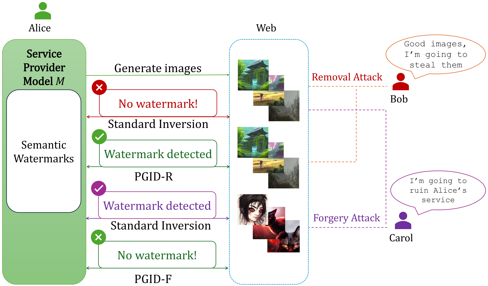

# PGID: Progressive Guided Inversion and Denoising for Robust Watermark Detection (NeurIPS 2026)
[](https://arxiv.org/abs/2605.09319)

Official Implementation of the paper *"PGID: Progressive Guided Inversion and Denoising for Robust Watermark Detection"*.

<p align="center">
  
</p>

## Overview
Semantic watermarks are a state-of-the-art watermarking paradigm for diffusion models. This paradigm functions by embedding watermark signals into the initial latent noise and retrieving the watermark from the generated image through diffusion inversion. 

However, their dependence on diffusion inversion makes them vulnerable to imprint forgery and removal attacks. We introduce a **unified training-free** latent noise extraction framework that **recovers removed watermarks** and **identifies forged instances**.

 
## Installation
Before starting, please read the [LICENSE](LICENSE.md) of this repository.
### 1. Clone the repository
```bash
git clone https://github.com/MinhQDuong/PGID.git
```
### 2. Create a conda environment and install dependencies
If you have not installed conda, please follow the instructions [here](https://docs.conda.io/projects/conda/en/latest/user-guide/install/index.html) to install it first.
```bash
cd PGID
conda create -n pgid python=3.10.19
conda activate pgid
pip install -r requirements.txt
```
All code is run on NVIDIA L40 GPU with CUDA 12.4.

## Usage
### Dataset Preparation
We use prompts from the [Stable Diffusion Prompts](https://huggingface.co/datasets/Gustavosta/Stable-Diffusion-Prompts) dataset to generate images. For running forgery attacks, we use cover images from the [ImageNet](https://www.image-net.org/) and [MS-COCO](https://cocodataset.org/) dataset. A small subset of prompts and cover images is provided in this repository for convenient experimentation.

### Quick Start
The main script, `run.py`, provides a unified pipeline for generating watermarked images, performing imprint attacks, running PGID defense, and evaluating the results. 

We denote the removal and forgery defense variants of PGID as PGID-R and PGID-F, respectively.

#### PGID-R

To perform a watermark removal attack, run PGID-R defense, and evaluate the results:

```bash
python run.py \
    --wm_type GS \
    --attack_type removal \
    --num_images 1 \
    --out_dir out_results_GS
```

#### PGID-F

To perform a watermark forgery attack, run PGID-F defense, and evaluate the results:

```bash
python run.py \
    --wm_type GS \
    --attack_type forgery \
    --cover_images_dir cover_images/ms_coco \
    --num_images 1 \
    --out_dir out_results_GS
```
By default, both the target provider and attacker models use **Stable Diffusion 2.1**. Please refer to our paper for more details on the experimental configurations. A full run on one image takes approximately 20 minutes on an NVIDIA L40 GPU.

### Supported Watermarking Methods

You can choose which watermarking method to use with the `--wm_type` argument from the following options:

| Argument | Watermarking Method |
|---|---|
| `GS` | Gaussian Shading |
| `TR` | Tree-Ring Watermark |
| `PRC` | PRC Watermark |
| `T2SMark` | T2SMark |

### Output Structure

The pipeline saves generated watermarked images, attacked images, and evaluation results to the directory specified by `--out_dir`.

For example, running a removal attack with `--out_dir out_results_GS` produces:

```text
out_results_GS/
└── attack=removal/
    ├── watermarked_images/
    ├── attacked_images_step_50/
    ├── attacked_images_step_100/
    ├── attacked_images_step_150/
    ├── all_results.csv
    └── summary.csv
```

- `watermarked_images/`: Watermarked images generated before the attack.
- `attacked_images_step_*/`: Attacked images saved at different optimization steps.
- `all_results.csv`: Detection and evaluation results for watermarked, attacked, and defended instances.
- `summary.csv`: Aggregated evaluation results across the processed images

## Acknowledgements

This repository incorporates code adapted from the publicly available implementations of [Imprint Attacks](https://github.com/and-mill/semantic-forgery.git), [PRC Watermark](https://github.com/XuandongZhao/PRC-Watermark.git), and [T2SMark](https://github.com/0xD009/T2SMark.git). We sincerely thank the respective authors for making their code implementations available.

## Citation

If you find our work useful in your research, please consider giving us a star and citing our paper:

```bibtex
@misc{duong2026pgid,
  title         = {PGID: Progressive Guided Inversion and Denoising for Robust Watermark Detection},
  author        = {Minh Quoc Duong and Chun Tong Lei and Chun Pong Lau},
  year          = {2026},
  eprint        = {2605.09319},
  archivePrefix = {arXiv},
  primaryClass  = {cs.CV},
  url           = {https://arxiv.org/abs/2605.09319}
}
```

